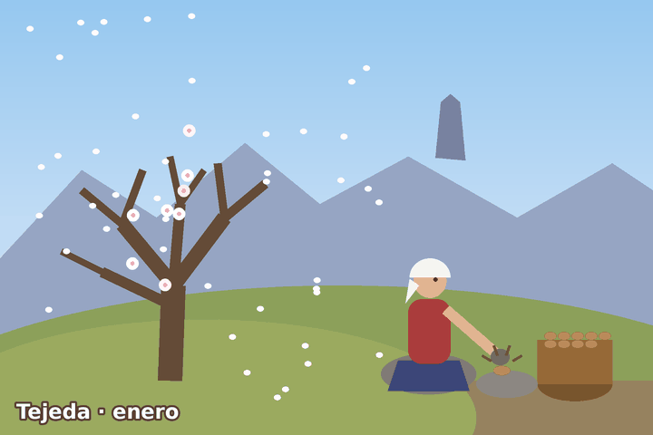
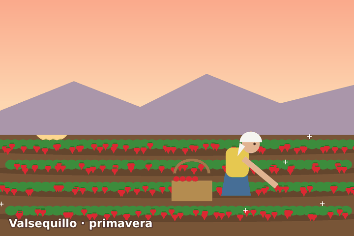
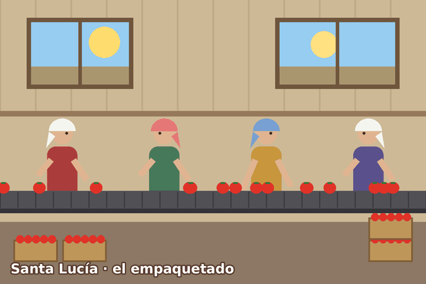
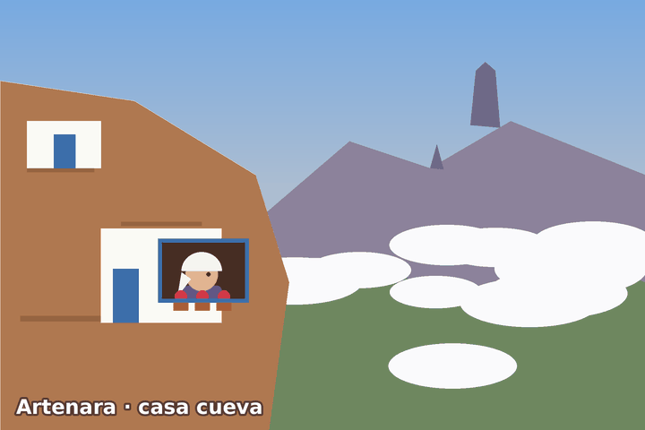

# 🌸✨ Mujeres Rurales de Gran Canaria ✨🌸
### ～ (ﾉ◕ヮ◕)ﾉ*:･ﾟ✧ a super kawaii layout practice ✧ﾟ･: *ヽ(◕ヮ◕ヽ) ～

🍓 · 🌸 · 🍅 · 🏔️ · 💌 · 🌸 · 🍓 · 🌸 · 🍅 · 🏔️ · 💌

---

## 🎀 What is this? (｡♥‿♥｡)

Hiii~! 💕 This is my **layout practice** (*práctica de maquetado*) ✂️📐
It's the **continuation of my rural women template** 👩‍🌾🌾, where I learned to build a page with **containers** using only **HTML**! 🥺👉👈

The page is a little tribute to the **rural women of Gran Canaria** 🇮🇨💖, celebrating the **International Day of Rural Women (October 15th)** 🗓️✨

---

## 🧸 What's inside? (っ˘ω˘ς )

| 🌷 Part | 💭 What it does |
|---|---|
| 📝 **Text** | The story of the rural women of Gran Canaria 🌾 |
| 📊 **Table** | 5 amazing women with their photo, island, sector and why they matter 💪✨ |
| 📦 **Container** | 1 big box 🎁 with **4 columns** inside + **2 footers** 🦶🦶 |
| 💌 **Postcards** | 4 animated postcards from different villages! 🥹 |

### 💌 The kawaii postcards ～☆

| 🌸 Tejeda | 🍓 Valsequillo |
|:---:|:---:|
|  |  |
| *Almond trees bloom white like snow* ❄️🌸 | *Strawberries picked early in the morning* 🌅🍓 |

| 🍅 Santa Lucía | 🏔️ Artenara |
|:---:|:---:|
|  |  |
| *Hundreds of women packing tomatoes* 📦🍅 | *A cave house looking at Roque Nublo* 🏠☁️ |

> 🌼 *The postcards are imaginary, but their stories repeat in every village of the island* 🌼

---

## 🍡 What I practiced ٩(◕‿◕｡)۶

- 🎁 `div` with `id` → `#contenedor`, `#centro1` ~ `#centro4`, `#pie1`, `#pie2`
- ⬅️ `float: left` to put the boxes side by side
- 🧹 `clear: both` so the footers go under everything
- 🎨 Inline `style` for colors and borders
- 🖼️ Images & GIFs with `` and links with `<a>`
- 📊 Tables with `<table>`, `<tr>`, `<th>` and `<td>`

---

## 🌈 How to see it? (✿◠‿◠)

1. 📥 Download or clone this repo
2. 📂 Keep all the images and GIFs in the **same folder** as `maquetado.html`
3. 🖱️ Double click `maquetado.html` and enjoy~ ✨

---

### 🌸 Made with 💖 by **Michaell Torres** 🌸
#### 🎓 2º SMR · IES Lomo de la Herradura 🎓

ʕ•ᴥ•ʔ 🍓 (◕ᴗ◕✿) 🌸 (づ｡◕‿‿◕｡)づ 💌 (˶ᵔ ᵕ ᵔ˶) 🍅 ʕっ•ᴥ•ʔっ

*thank you for visiting~ have a sparkly day!* ✨🌷✨

